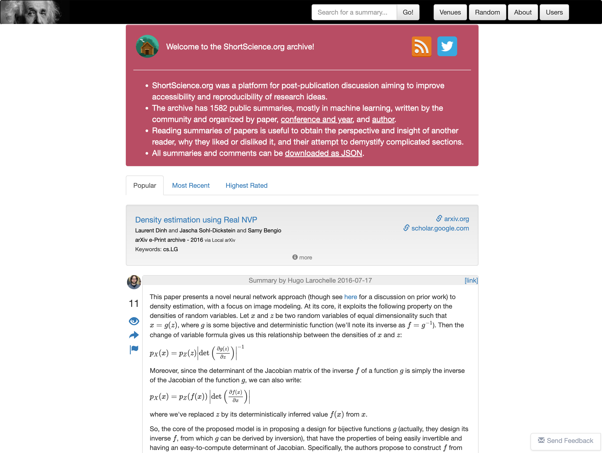

# ShortScience.org archive

ShortScience.org was a platform for post-publication discussion of research
papers. Researchers wrote summaries of papers, and others voted on and
commented on them. The site was archived on November 20, 2026 and is now
read-only.

This branch is the whole archived site as static files:

- `shortscience.json`: every public summary with its comments, the papers they
  summarize, and the authors. Anonymous summaries have no author.
- `paper/`, `user/`, `venue/`: one HTML page per paper with summaries, per
  author, and per venue and year.
- `rss.xml`, `rss-all.xml`, `rss-full.xml`, `sitemap.xml`.
- `_nginx/`: lookup tables that let nginx keep the old URLs working
  (`/paper?bibtexKey=...`, `/user?name=...`, `/venue?key=...&year=...`).

Summaries remain the work of their authors. ShortScience.org did not ask for
copyright to be transferred.

The pages are generated from the site's database dump. The old PHP code is on
the `master` branch.
